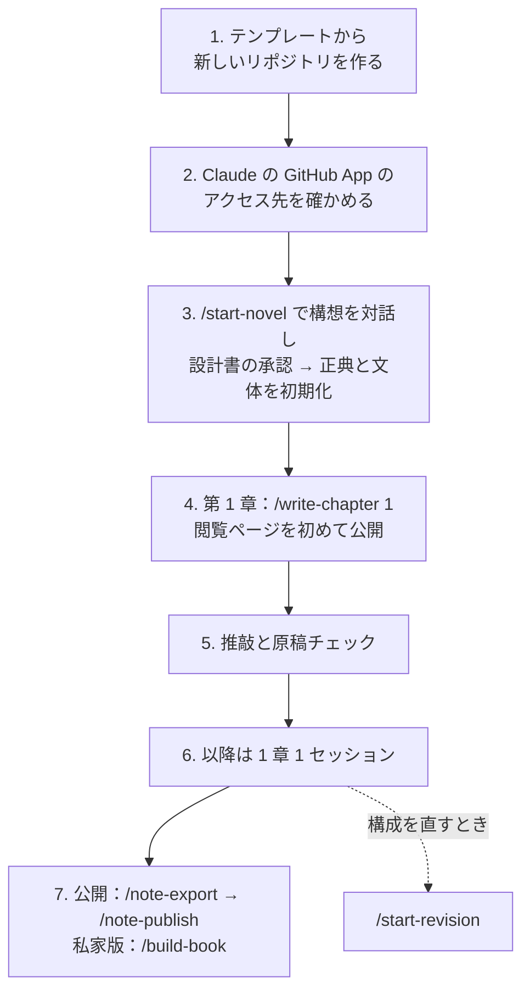

<!-- novel-intro:start -->
# 長編小説の執筆環境（雛形）

Claude と一緒に長編小説を書くための、GitHub のテンプレート リポジトリです。
正典（設定・構成・記録のファイル）、執筆と点検のスキル、原稿の閲覧ページ、note への公開までの手順をまとめてあります。
作品の中身は入っていません。ジャンルや題材は、新作を始めるときに決めます。

> [!NOTE]
> 2026 年 11 月時点の情報です。
> Claude と note の画面や機能は変わりやすく、手順に書いた名前が変わっている場合があります。

新作のリポジトリでは、`/start-novel` がこの節を作品の紹介に書き換えます。
<!-- novel-intro:end -->

## 新作を始める手順



1. **テンプレートから作る**
   GitHub でこのリポジトリを開き、**Use this template** › **Create a new repository** を選びます。
   名前は `novel-<作品の短い名前>`、公開範囲は **Private** にします。**Include all branches** はオフのままにします。
2. **Claude の GitHub App のアクセス先を確かめる**
   GitHub の **Settings** › **Applications** › Claude の **Configure** を開きます。
   **All repositories** なら作業は要りません。**Only select repositories** なら、新しいリポジトリを追加して **Save** を押します。
   追加していないと、セッションからの push が 403 エラーになります。
3. **構想と正典の初期化**
   新しいセッションで、`docs/prompts/chapter-session.md` の「構想のセッション」の依頼文を使います。
   `/start-novel` が対話で構想を固め、初稿の設計書（題名と主人公、真相と時系列、情報開示の基準線）の承認を取ってから、`bible/`・`plot/`・`.claude/rules/style-genre.md`・`novel.config.json` を書き、この README の冒頭を作品の紹介に書き換えます。
4. **第 1 章**
   新しいセッションで「章の執筆のセッション」の依頼文を使います。`/write-chapter 1` が場面設計を示し、合意のあとで本文を書き、別のエージェントで点検し、記録を更新して push します。
   最初の push のあと、Claude が原稿の閲覧ページ（Artifact）を作り、URL を `novel.config.json` に書き戻します。
5. **推敲と原稿チェック**
   `/polish` で推敲します。
   原稿チェックは、閲覧ページの行番号で「〇行目」と指摘する形で進めます（「原稿チェックのセッション」の依頼文）。
6. **以降は 1 章 1 セッション**
   次の章は新しいセッションで始めます。設定と経過はすべてファイルに残っています。
7. **公開と私家版**
   note への公開は `/note-export`（入稿用テキストの書き出し）と `/note-publish`（下書き保存、確認後に予約・公開）で行います。
   公開前に通しで読んでもらう一冊は `/build-book` で作ります。

構成を大きく直すときは、`/start-revision` で改稿用のブランチと設計文書を用意します。

### 作業する環境

ふだんは **Claude のデスクトップ アプリ**で作業します。新しいセッションの依頼文の 1 行目でリポジトリを書き込みで接続すると、Claude がリポジトリを読み込み、スキル（`.claude/`）をそのまま使います。
原稿の閲覧ページは、アプリのサイドパネルで開けます。note への投稿で使う内蔵ブラウザーも、アプリが開いていてオンラインのときに使えます。

補足：Mac の手元のファイルで直接作業したいときは、リポジトリを clone して VS Code の Claude Code からも同じスキルを使えます。
その場合は、作業の前に `git pull`、終わったら push して、デスクトップ アプリのセッションと食い違わないようにします（[運用](docs/operations.md)の「Mac で直接作業するとき」）。

## 1 章の流れ


## ディレクトリ構成

```text
.
├── CLAUDE.md                 Claude への指示（毎セッション読み込まれる）
├── LICENSE                   雛形のライセンス (MIT)。新作では /start-novel が docs/template-LICENSE へ移す
├── README.md                 この説明
├── novel.config.json         作品名・著者・閲覧ページ・note の設定
├── bible/                    正典：主題・人物・世界・年表
├── plot/                     正典：章構成・伏線・未確定事項
├── log/                      正典：継続性ログ（archive/ は改稿前の記録）
├── chapters/                 本文（NN_章題.md）
├── docs/
│   ├── operations.md         運用（セッション、ブランチ、設定ファイル、同期）
│   ├── canon-format.md       正典の各欄の書式と架空の記入例
│   ├── prompts/              セッションの依頼文のひな形
│   ├── design/               初稿の設計書（/start-novel が作る）
│   ├── templates/            設計書の型（初稿用・構成改稿用）
│   └── style-presets/        ジャンル別の文体ルールの見本
├── publish/note/             note 入稿用の定型・見出し画像・書き出し
├── tools/                    count_chars.py・build_viewer.py・build_book.py
└── .claude/
    ├── rules/                style-base.md（土台）・style-genre.md（ジャンル）
    ├── skills/               スキル（下の表）
    └── agents/               continuity-checker
```

## スキル

| スキル | 使う場面 |
| :-- | :-- |
| `/start-novel` | 新作の最初に 1 回。構想の対話 → 初稿の設計書の承認 → 正典の初期化 |
| `/write-chapter <章番号>` | 章を書く。設計 → 執筆 → 字数の実測 → 独立点検 → 記録の更新 → push |
| `/polish <ファイル>` | 推敲。指摘を行番号つきで示し、選んだものだけ反映する |
| `/continuity-check [範囲]` | 既刊章と正典の矛盾、未回収の伏線を、別のエージェントで洗い出す |
| `/start-revision <版名>` | 構成改稿を始める。設計文書の型を写し、改稿前の記録を保管場所へ移す |
| `/build-book` | 私家版の EPUB と HTML を組み立てる |
| `/note-export <章番号>` | 章を note 入稿用のテキストに書き出す |
| `/note-publish <章番号>` | note に下書き保存し、確認を取ってから予約・公開し、公開後の導線を整える |

## 詳しい説明

- [運用（セッション、ブランチ、設定ファイル、同期）](docs/operations.md)
- [正典の書式と記入例](docs/canon-format.md)
- [セッションの依頼文のひな形](docs/prompts/chapter-session.md)
- [note 各話の定型と公開の手順](publish/note/template.md)

## ライセンスと免責

| 対象 | ライセンス |
| :-- | :-- |
| このリポジトリのすべてのファイル (スキル、エージェント、ツール、文書、ひな形) | [MIT](LICENSE) |

- このテンプレートから作ったリポジトリで書く原稿や設定などの権利は、書いた人にあります。
  `/start-novel` は、新作のリポジトリで `LICENSE` を `docs/template-LICENSE` に移します。雛形から写した部品の MIT の表示はそこに残り、原稿にライセンスを付けるかどうかは作者が決めます。
- このリポジトリは個人の制作物です。Anthropic、note 株式会社とは関係がなく、両社が承認、保証したものではありません。
- Claude は Anthropic の、note は note 株式会社の商標または登録商標です。
- 生成 AI を使って書いた作品を公開したり、公募に応募したりするときは、各サービスの規約や募集要項を確かめてください。
